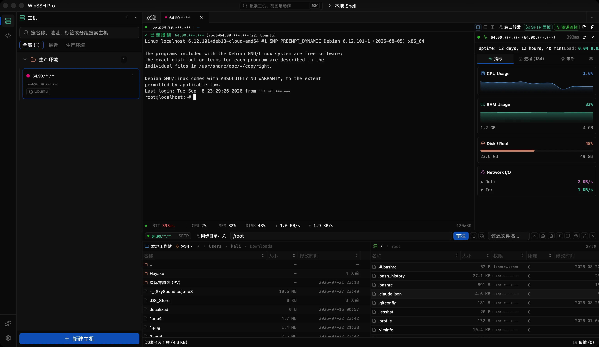

<div align="center">


# WinSSH Pro

跨平台桌面 SSH 客户端，Rust + GPUI 原生渲染，渲染目标 120fps。

[](https://github.com/lantongxue/winssh-pro/releases)
[](https://github.com/lantongxue/winssh-pro)
[](LICENSE)

[winssh.net](https://winssh.net) · [Releases](https://github.com/lantongxue/winssh-pro/releases) · [Issues](https://github.com/lantongxue/winssh-pro/issues)



</div>

<br/>

## 功能

- AI 助手面板可以读取终端内容、传输文件，支持 OpenAI Responses 协议
- 终端内核是 zed 同款的 `alacritty_terminal`（VT 解析、屏幕缓冲、PTY），整帧走 GPU 渲染
- SSH、SFTP、Telnet、串口、VNC、RDP、FTP、WebDAV、S3 在同一个窗口里管理
- 文件传输支持拖拽、断点续传和 Zmodem（rz/sz），SFTP 面板内嵌文本编辑器
- 主机按分组管理；密码、私钥、令牌统一放在凭据保险箱，建主机时取用
- 支持 ProxyJump 跳板主机和 SOCKS5 代理，可全局配置也可按主机单独指定
- 本地、远程、动态三类端口转发，配置跟随主机保存
- 内嵌 EasyTier 组网，网络就绪后主机自动经虚拟网络接入
- Clash 订阅管理
- 主机信息面板实时显示 CPU、内存、磁盘、网络吞吐与进程列表
- 命令片段库、事件日志、全量数据备份与恢复

## 安装

| 平台 | 安装包 |
| --- | --- |
| Windows | `winssh-pro-<version>-setup.exe` |
| macOS | `winssh-pro-<version>.dmg`（Apple Silicon / Intel） |
| Linux | `.deb` / `.rpm` |

在 [Releases](https://github.com/lantongxue/winssh-pro/releases) 下载对应平台的最新版本。

## 从源码构建

前置依赖：

```sh
rustup default stable

# macOS
brew install protobuf

# Debian / Ubuntu
sudo apt install protobuf-compiler

# Windows 不需要手动装，protoc 和 wintun.dll 由构建脚本处理
```

拉取代码并编译：

```sh
git clone https://github.com/lantongxue/winssh-pro.git
cd winssh-pro
git submodule update --init --recursive
cargo run --release
```

`refs/` 下的 gpui-kit 和 alacritty 是 path 依赖，来自 git 子模块。子模块没拉下来无法编译。

## 技术栈

| 层 | 选用 |
| --- | --- |
| UI 框架 | [GPUI](https://github.com/zed-industries/zed)，zed 的原生渲染引擎 |
| 组件库 | [gpui-kit](https://github.com/lantongxue/winssh-pro/tree/main/refs/gpui-kit)，shadcn 风格的 GPUI 组件框架 |
| 终端内核 | [alacritty_terminal](https://github.com/alacritty/alacritty)，zed 钉版的 fork |
| SSH / SFTP | [russh](https://github.com/warp-tech/russh) |
| 组网 | [EasyTier](https://github.com/EasyTier/EasyTier) |
| 数据层 | SeaORM + SQLite |

工程是一个 Cargo workspace：根包只留应用外壳，各协议后端和领域层拆成 `crates/` 下的 20 多个独立 crate。分层规则、渲染性能预算（每帧 8.3ms）和代码规范见 [AGENTS.md](AGENTS.md)。

## 参与贡献

欢迎提交 Issue 和 PR。动手前请先读 [AGENTS.md](AGENTS.md)，里面的分层和性能约束是硬性要求。

## 开源协议

[Apache License 2.0](LICENSE) © 2026 WinSSH Pro contributors
